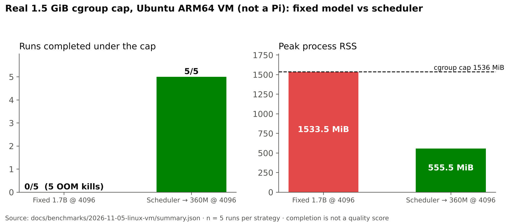
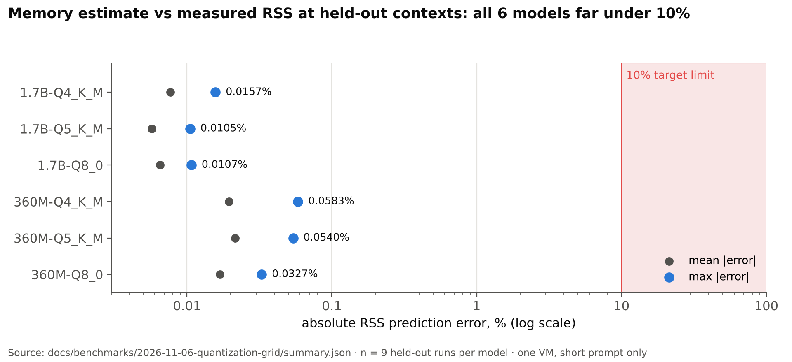

<h1 align="center"> NanoClaw-Next</h1>

<p align="center"><b>An adaptive scheduler for running local LLMs on memory-constrained devices.</b><br>
Picks the best model × context that fits the memory free right now, and steps down a rung instead of crashing.</p>

<!-- badges:start -->
<p align="center">
  <a href="docs/benchmarks/2026-11-05-linux-vm/REPORT.md"></a>
  <a href="docs/benchmarks/2026-11-06-quantization-grid/summary.json"></a>
  <a href="docs/benchmarks/2026-11-06-quantization-grid/REPORT.md"></a>
  <a href="docs/ZIG_VERSION_REQUIREMENT.md"></a>
  <a href="src/tests.zig"></a>
</p>
<!-- badges:end -->

<p align="center">
  <br>
  <sub>Real 1.5 GiB cgroup cap on an Ubuntu ARM64 VM, five runs per strategy. A VM result, not a Pi result; completion is not a quality score. <a href="#results">More results ↓</a></sub>
</p>

Given the memory actually free on the device right now, a context-length need and an optional deadline, NanoClaw-Next picks the best model × context that fits and runs it through llama.cpp. When a run gets OOM-killed, crashes or times out, it steps down a rung and retries instead of failing. Every decision prints the reason.

```
$ nanoclaw-next plan --available-mb 1800
[scheduler] usable memory 1544 MB (available 1800 MB - headroom 256 MB)
[scheduler]   smollm2-1.7b   ctx=4096   need  1952 MB  -> exceeds memory
[scheduler]   smollm2-1.7b   ctx=2048   need  1568 MB  -> exceeds memory
[scheduler]   smollm2-1.7b   ctx=1024   need  1376 MB  -> fits
[plan] run smollm2-1.7b at ctx 1024 (est. 1376 MB)
```

> **Why:** on a Pi 5 or Jetson, memory is the limit that bites. Today's tools (Ollama, llama-server, llama-swap) use static knobs and fail hard when memory runs out. NanoClaw-Next works one level above llama.cpp's own `--fit`: which model, deadlines, sensitivity, and recovery after failure. See [docs/RESEARCH_SYNTHESIS.md](docs/RESEARCH_SYNTHESIS.md) and [docs/PLAN.md](docs/PLAN.md).

## Status

```
M1  honest foundation          ██████████  done          scheduler, estimator, backend, sandbox allowlist, CLI
M2  evidence on real hardware  ████████░░  3/4 items     VM only · pressure (PSI) experiment not run · physical Pi pending
M3  kernel isolation           ░░░░░░░░░░  not started   Landlock / seccomp
M4  persistent engine          ░░░░░░░░░░  not started   plus optional cloud backend
```

M2 items per [docs/PLAN.md](docs/PLAN.md): capped comparison ✅ (VM), estimate-error grid ✅ (VM), results table in this README ✅, PSI pressure experiment ⛔ not run.

### What works and how it was checked

| Capability | Status | Evidence |
|---|---|---|
| Live memory: Linux `MemAvailable` + cgroup v2 limit + PSI; macOS `memorystatus` | ✅ | Unit tests with fixtures; live reads on macOS and Ubuntu ARM64 VM; real cgroup cap verified |
| Model cost from GGUF metadata (weights + KV cache per token) | ✅ | Unit tests on synthetic GGUF headers |
| Degradation ladder: shrink context → smaller model → cloud (never if `--sensitive`) → refuse | ✅ | 7 scheduler unit tests + CLI runs |
| llama.cpp backend via command template; per-run peak RSS from `wait4` | ✅ | Real SmolLM2 1.7B / 360M on llama.cpp 0.7.0; `wait4` RSS matches `/usr/bin/time -l` within 1 MB |
| Timeout → exclude rung and retry | ✅ | Real: a 1.7B run killed at a 1.5 s deadline fell back to the 360M |
| OOM kill → exclude rung and retry | ✅ | Real llama.cpp cgroup OOM recovery on Linux VM with a deliberately overstated memory budget; supervisor kept alive by `OOMPolicy=continue` |
| Calibration: measured RSS, tokens/s and startup time feed back into estimates | ✅ | 54 held-out Linux VM runs across two model sizes and Q4/Q5/Q8: max RSS error 0.0583%; [grid report](docs/benchmarks/2026-11-06-quantization-grid/REPORT.md) |
| Tool execution: executable allowlist + hard SIGKILL timeout | ✅ | Unit tests: `/usr/bin/curl`, `bash -c`, `python3 -c` denied; hung command killed in under 2 s |
| Kernel isolation (Landlock / seccomp) | ❌ planned (M3) | Allowlisted tools run with your full user permissions |
| Cloud backend | ❌ planned (M4) | The scheduler supports it; no backend ships, so it is never chosen |
| Head-to-head benchmark vs fixed llama.cpp under a memory cap | Preliminary Linux VM evidence (M2) | Fixed 1.7B: 0/5; adaptive 360M: 5/5 under a real 1.5 GiB cgroup cap. [Report](docs/benchmarks/2026-11-05-linux-vm/REPORT.md); Pi results pending |

Experimental agent scaffolding (in-memory hierarchical memory, tool-name aliases) is kept but is not the focus. `src/skills/` and `src/memory.zig` are design stubs that aren't wired in.

### Measured on a Mac with real models

MacBook (Apple Silicon, 18 GB, macOS 27), llama.cpp 0.7.0 (Homebrew), CPU only (`-ngl 0`, to mimic a Pi), SmolLM2-Instruct Q4_K_M from bartowski (SHA-256 checked). Peak RSS from `wait4` per run; raw data in `state/*.csv` after `calibrate` / `bench`.

**Memory estimate vs measured peak RSS**

| Model | ctx | Uncalibrated v0 (weights + KV + 128 MB) | Uncalibrated now (2× weights + KV + 128 MB) | Calibrated | Measured |
|---|---|---|---|---|---|
| 1.7B | 512 | 1230 MB (−44%) | 2237 MB (+1%) | 2214 MB | 2214 MB |
| 1.7B | 2048 *(held out)* | 1518 MB | 2525 MB | 2502 MB | 2502 MB |
| 1.7B | 4096 | 1902 MB (−34%) | 2909 MB (+1%) | 2886 MB | 2886 MB |
| 360M | 512 | 406 MB (−17%) | 664 MB (+36%) | 491 MB | 489 MB |
| 360M | 2048 *(held out)* | 466 MB | 724 MB | 551 MB | 549 MB |
| 360M | 4096 | 546 MB (−13%) | 804 MB (+27%) | 631 MB | 630 MB |

- The KV-cache term from GGUF metadata is exact: measured slopes are 192 KB and 40 KB per token.
- The first default under-estimated by up to 44%. llama.cpp's CPU backend repacks weights into a second copy while the mmapped file stays resident: 2214 MB → 1210 MB with `--no-repack`. Uncalibrated estimates now assume that worst case, and `calibrate` measures the real figure.

**Scheduler decisions (`bench`, 5 runs each, "Explain what swap memory is in two sentences.")**

| Scenario | Chosen | Attempts | Wall p50 | Peak RSS |
|---|---|---|---|---|
| Unconstrained | 1.7B @ 4096 | 1 | 2109 ms | 2887 MB |
| `--available-mb 1200` | 360M @ 4096 | 1 | 530 ms | 630 MB |
| `--deadline-ms 1500`, before startup-cost fix | 1.7B, killed at 1.5 s → 360M | 2 | 528 ms | 630 MB |
| `--deadline-ms 1500`, after fix (predicts 1.7B ≈ 2100 ms) | 360M @ 4096 | 1 | 530 ms | 630 MB |

**Quality, not just fit:** for "show how much disk space is free", the 1.7B produced `df`. The 360M produced `ls /dev/disk/by-id/` on one run and a commented multi-line script on another. `run` therefore prefers the best model for both steps; the small model is used only under memory or deadline pressure.

<a id="results"></a>

## Results

### Fixed model vs scheduler under a memory cap


Under a real cap the fixed 1.7B run was OOM-killed every time, while the scheduler chose the 360M and finished every run. The smaller model has a quality tradeoff. The source data is [docs/benchmarks/2026-11-05-linux-vm/summary.json](docs/benchmarks/2026-11-05-linux-vm/summary.json).

### Memory estimate accuracy



After calibration, predictions stayed within 0.06% of measured peak RSS at held-out contexts for all six model × quantization pairs. This holds for one VM, one backend and a short prompt; calibration is device-specific, and it says nothing about Pi performance. Source: [docs/benchmarks/2026-11-06-quantization-grid/summary.json](docs/benchmarks/2026-11-06-quantization-grid/summary.json). Regenerate with `python3 scripts/make_figures.py`.

### First Linux VM comparison (2026-11-05)

Ubuntu 24.04 ARM64, 4 virtual CPUs / 4 GiB RAM on Apple Silicon; CPU-only llama.cpp build 11669. Same prompt, context 4096, maximum 128 tokens, temperature 0, seed 1; five alternating runs per strategy. A fresh 1536 MiB cgroup cap with swap disabled applies to each run; the VM Linux page cache is cleared before each run.

| Strategy | Completed | Successful end-to-end p50 / p95 | Max process RSS | Real OOM kills |
|---|---:|---:|---:|---:|
| Fixed SmolLM2 1.7B @ 4096 | 0/5 | N/A | 1533.5 MiB | 5 |
| Scheduler → SmolLM2 360M @ 4096 | 5/5 | 810 / 911 ms | 555.5 MiB | 0 |

End-to-end time includes scope creation, scheduling and model loading. Completion is not a quality score; the smaller model has a quality tradeoff. A separate forced-overestimate check recovered from a real OOM on attempt two. Q4 memory estimates at held-out context 2048 were within 0.2% for both models. These are preliminary **VM** results, not Pi performance or completion of M2. See the [method, raw data and limitations](docs/benchmarks/2026-11-05-linux-vm/REPORT.md).

### Quantization/context grid (2026-11-06)

On the same Ubuntu ARM64 VM, temporarily enlarged to 8 GiB, both model sizes were calibrated independently at contexts 512/4096. Each quantization then ran three times at held-out contexts 1024/2048/8192 under a 6 GiB cgroup cap. All **54/54** runs completed without OOM kills; every prediction matched NanoClaw's production `plan` formula.

| Model | Q4_K_M worst RSS error | Q5_K_M worst RSS error | Q8_0 worst RSS error |
|---|---:|---:|---:|
| 1.7B | 0.0157% | 0.0105% | 0.0107% |
| 360M | 0.0583% | 0.0540% | 0.0327% |

This meets the <10% target **for this VM, backend and short-prompt grid**; calibration is device-specific. It does not establish Pi performance or arbitrary-prompt accuracy. [Method, RSS ranges and raw measurements](docs/benchmarks/2026-11-06-quantization-grid/REPORT.md).

## Build facts

| Metric | Value | Method |
|---|---|---|
| Binary, aarch64-linux-musl | 147 KB | `zig build-exe src/main.zig -target aarch64-linux-musl -OReleaseSmall -fstrip`, Zig 0.15.2, static |
| Binary, x86_64-linux-musl | 158 KB | same, x86_64 target |
| Unit tests | 32/32 pass | Zig 0.15.2, macOS arm64 and Ubuntu ARM64 VM (2026-11-05) |
| Selftest | 10/10 pass | `nanoclaw-next selftest` on macOS and Ubuntu ARM64 VM |

The binary is small because inference runs in a separate llama.cpp process; binary size is not the point of this project. Peak inference memory is the llama.cpp process's, reported per run by `bench`.

## Quick start

Build (Zig 0.15.2):

```bash
zig build -Doptimize=ReleaseSmall
```

Install llama.cpp and download a couple of GGUF models of different sizes (e.g. SmolLM2 1.7B and 360M, Q4_K_M), then:

```bash
./zig-out/bin/nanoclaw-next init
```

Edit `nanoclaw-next.conf`:

```ini
llm_cmd=llama-completion -m {model} -c {ctx} -n {n} -f {prompt_file} -cnv -st --no-display-prompt --temp 0 -s 1 -ngl 0 --simple-io
model=smollm2-1.7b,models/SmolLM2-1.7B-Instruct-Q4_K_M.gguf,3
model=smollm2-360m,models/SmolLM2-360M-Instruct-Q4_K_M.gguf,1
```

Placeholders `{model}`, `{ctx}`, `{n}` and `{prompt_file}` are filled per run; the prompt is also sent on stdin. `-cnv -st` applies the model's chat template for one turn (without it, instruct models return end-of-text immediately). Drop `-ngl 0` to use the GPU; GPU-resident weights don't show in RSS, so calibration then learns speed only. Flags are as of llama.cpp 0.7.0; check `llama-completion --help`.

```bash
./zig-out/bin/nanoclaw-next calibrate                   # measure each model once (RSS, tok/s, startup)
./zig-out/bin/nanoclaw-next probe                       # device memory + per-model cost
./zig-out/bin/nanoclaw-next plan --available-mb 1200    # what would run with 1.2 GB free?
./zig-out/bin/nanoclaw-next bench --prompt "Explain swap in one paragraph" --runs 5
./zig-out/bin/nanoclaw-next run --prompt "show disk usage"
```

#### Try it without models

```bash
python3 -I scripts/dev/make_test_models.py models   # sparse fake GGUFs (~36 KB on disk)
# in nanoclaw-next.conf:
#   llm_cmd=scripts/dev/fake-llm.sh -m {model} -c {ctx} -n {n}
#   model=fake-1.7b-oom,models/fake-1.7b-q4-oom.gguf,3     # simulates an OOM kill
#   model=fake-360m,models/fake-360m-q4.gguf,1
./zig-out/bin/nanoclaw-next bench --prompt hi --runs 3   # watch it step down after the OOM
```

## Commands

| Command | What it does |
|---|---|
| `init` | Writes `nanoclaw-next.conf` with safe defaults |
| `probe` | Memory snapshot, isolation status, per-model GGUF info and cost estimates, default decision |
| `plan` | Dry-runs the scheduler. Flags: `--ctx --min-ctx --tokens --deadline-ms --sensitive --prefer quality\|speed --available-mb` |
| `calibrate` | Runs every model at `min_ctx` and `desired_ctx`, bypassing the scheduler, and records peak RSS, tokens/s and startup time |
| `bench` | Repeats a request; writes CSV (`run,ok,model,ctx,attempts,wall_ms,peak_rss_mb,gen_tokens,gen_ms,error`); prints p50/p95 and peak RSS; feeds calibration |
| `run` / `prompt` | Agent cycle: plan → one command (both prefer quality) → allowlisted execution |
| `selftest` | Checks that need no model, to run on the target device |

## How it works

```
need(model, ctx) = GGUF file size                                   (weights, mmapped)
                 + layers × kv_heads × (k_dim + v_dim) × 2 B × ctx  (f16 KV cache)
                 + overhead                                         (weights + 128 MB until measured)
latency          = startup (load + prompt) + max_new_tokens / tokens_per_sec
usable          = min(MemAvailable, cgroup memory.max − memory.current, memory_budget_mb) − headroom
```

For each model (best quality first, or smallest first with `--prefer speed`), the scheduler tries the requested context, halving it down to `min_ctx` until `need ≤ usable`. A model whose tokens/s can't meet `--deadline-ms` is skipped. Speed is measured where possible. Otherwise it's inferred from a measured model on the same device: decoding is memory-bandwidth bound, so tokens/s scales with 1/weight size. That way an unmeasured model is never assumed to be fast. Then come cloud (only if configured and not sensitive) and refusal. After each successful run, peak RSS, tokens/s and startup time are appended to `state/calibration.tsv`. If a run's RSS is far below the weight size (weights in GPU/Metal memory), its memory reading is ignored and only its speed is used.

## Repository layout

| Path | What's there |
|---|---|
| `src/edge/` | The core: `sysmem`, `gguf`, `estimate`, `scheduler`, `proc`, `engine` |
| `src/runtime/` | Tool sandbox (allowlist + timeout), timeout budget, rollback journal |
| `src/app.zig` | Commands: probe / plan / bench / run / selftest |
| `src/skills/`, `src/memory*` | Experimental agent scaffolding; design stubs, not wired in |
| `docs/` | [Research synthesis](docs/RESEARCH_SYNTHESIS.md), [plan](docs/PLAN.md), [Zig requirement](docs/ZIG_VERSION_REQUIREMENT.md) |
| `docs/benchmarks/` | Raw data, drivers and reports for each M2 measurement |
| `docs/assets/` | Logo mark and figures |
| `docs/archive/` | Original design notes (aspirational; superseded by `docs/`) |
| `scripts/` | `setup.sh`, `release-phase0.sh`, `compare-linux.sh`, `make_figures.py`, `update_badges.py`, dev fixtures |
| `tests/` | `test_readme_badges.py`: fails when the README badges drift from the evidence |

## Reproduce

1. Build with Zig 0.15.2 and run the unit tests: `zig build test` (or the macOS 27 fallback below).
2. Capped comparison on Linux: `scripts/compare-linux.sh`, or the controlled driver [run-linux-vm.py](docs/benchmarks/2026-11-05-linux-vm/run-linux-vm.py).
3. Estimate-error grid: [run-grid.py](docs/benchmarks/2026-11-06-quantization-grid/run-grid.py) after [download-models.py](docs/benchmarks/2026-11-06-quantization-grid/download-models.py). Both expect the prepared VM layout described in the reports.
4. Regenerate figures and badges: `python3 scripts/make_figures.py && python3 scripts/update_badges.py`.
5. Check the badges haven't drifted: `python3 -m unittest tests.test_readme_badges`.

## Known issues

- **macOS 27 + Zig 0.15.2:** `zig build` fails at link time (`undefined symbol: _sigemptyset`, …) because Zig 0.15.2 can't read the macOS 27 SDK. Workaround: target an older macOS explicitly. Zig then uses its bundled libc stubs:
  ```bash
  zig build-exe src/main.zig -target aarch64-macos.15.0 -femit-bin=nanoclaw-next
  zig test src/tests.zig -target aarch64-macos.15.0
  ```
- Each request starts a fresh llama.cpp process, so model load time is paid on every request. A persistent engine is M4 in the plan.
- Measured on an Apple Silicon Mac and an Ubuntu ARM64 VM, including real cgroup OOM. Physical Pi 5 measurements remain part of M2.
- PSI is reported but is not used to pre-emptively change a running model. The M2 pressure experiment still requires policy work.
- llama.cpp's own `--fit` (on by default) already adapts GPU layers and context for a single model. NanoClaw-Next works one level up: which model, deadlines, sensitivity, and recovery after failure.

## Naming

"NanoClaw" collides with an established project of the same name. A rename (e.g. *EdgeMorph*, *NanoEdge Runtime*) is under consideration, pending an availability check.

## Docs

[Plan](docs/PLAN.md) · [Research synthesis](docs/RESEARCH_SYNTHESIS.md) · [Linux VM report](docs/benchmarks/2026-11-05-linux-vm/REPORT.md) · [Quantization grid report](docs/benchmarks/2026-11-06-quantization-grid/REPORT.md) · [Zig requirement](docs/ZIG_VERSION_REQUIREMENT.md) · [Contributing](CONTRIBUTING.md) · [Changelog](CHANGELOG.md)

<sub>Not claimed yet: Raspberry Pi 5 results, pre-emptive step-down under memory pressure, kernel-level tool isolation, a cloud backend, or accuracy beyond the short-prompt VM grid.</sub>
